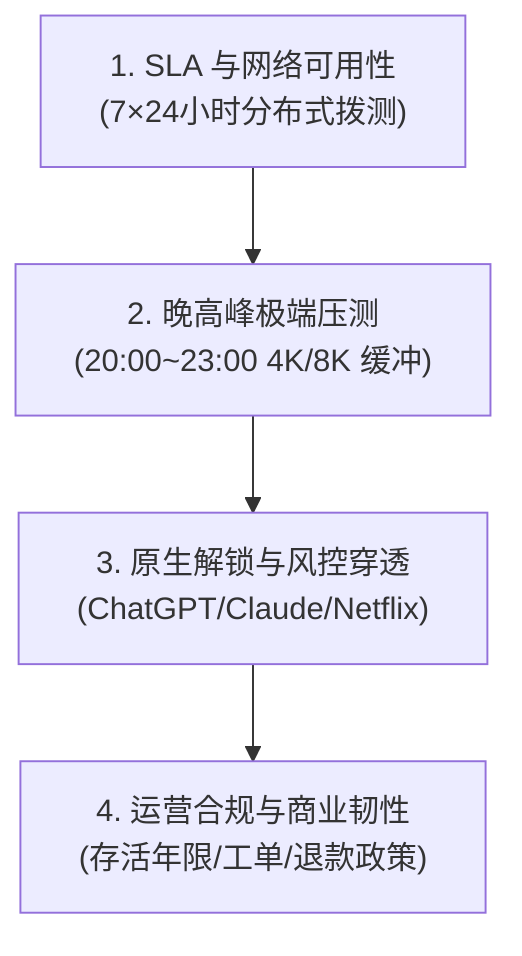

# 关于 AirPick · 机场推荐指南

**AirPick**（官方域名：[airpick.co](/)）创立于 2026 年，是由资深分布式系统架构师、网络安全工程师与出海内容策略团队共同发起的中文科学上网独立评测与研究平台。

我们的 Slogan 是：**Pick 你的机场，稳定又便宜**。

---

## 一、平台创立初衷

在高速发展的全球化与 AI 浪潮中，顺畅、安全、高效地获取海外科技资讯、科研文献与跨境商业资源，已经成为广大知识工作者、外贸从业人员与数字游民的刚需。

然而，中文翻墙市场长期面临巨大的信息不对称：
1. **水军与虚假宣传泛滥**：许多所谓评测站为获取高额返利，将严重超售的廉价机场包装成“千兆专线”。
2. **跑路欺诈频发**：打着“百元年付”、“终身买断”旗号的资金盘屡禁不止，损害普通用户权益。
3. **技术门槛高深莫测**：Fake-IP、TUN 模式、BGP 多线、Reality 伪装等专业术语让新手望而却步。

AirPick 秉承 **“数据说话、实测为王、透明客观”** 的根本原则，旨在撕开行业迷雾，帮助用户根据自身真实预算与业务场景，挑选出最称心如意的服务。

---

## 二、AirPick 四维严苛评测标准

所有被 AirPick 收录或横测的服务商，必须通过以下四重自动化与真机环境检验：

### 1. SLA 与网络可用性 (SLA Availability)
- 在全国三大运营商（中国电信、中国联通、中国移动）多省份部署探测节点。
- 每隔 5 分钟向目标服务商入口发起 TCP 握手与 HTTP 真连接延迟探测，持续记录丢包率与网络抖动。

### 2. 晚高峰极端压测 (Peak-Hours Stress Test)
- 重点评估每晚 **20:00 - 23:00** 国际公网出口最拥挤时段的抗 QoS 压制能力。
- 以 YouTube 4K 60帧（VP9/AV1 编码）秒开缓冲健康度、Fast.com 测速及外服电竞丢包率为硬性评判标准。

### 3. 原生解锁与反风控穿透 (Native Unlocking & Anti-Fraud)
- 真实真机环境测试：必须原生解锁 Netflix 非自制剧（非简单 DNS 劫持反代）。
- 穿透 OpenAI 及 Anthropic Claude 的严苛反作弊模型（测试 IP 欺诈度 Fraud Score 是否低于 20）。

### 4. 商业信誉与运营韧性 (Business Resilience)
- 严查域名注册时长、官方公告历史活跃频次与售后工单响应速度。
- 凡是有过恶意删库、无端清退用户历史的服务商，一律不予推荐或明确标注高风险预警。

---

## 三、客观中立与商业合作透明度声明

- **客观中立原则**：任何赞助或商业合作绝不干预 AirPick 的实际测速数据与评测结论。凡是测试不达标、晚高峰严重卡顿的品牌，我们均会如实指明缺点与适用短板。
- **佣金透明披露**：部分文章可能包含推广链接（Affiliate Links）。当读者通过链接购买时，我们可能会获得少许维护服务器的佣金，但这绝不会增加读者的任何购买成本。
- **信息核实声明**：对于品牌信息不确定的节点数量、中转机房或技术参数，我们一律明确标注“暂未核实”，绝不编造或夸大宣传。

---

## 四、免责声明与合规守则

1. AirPick 所发布的全部评测数据、技术文章与网络配置教程，**仅供计算机网络学术研究、跨境合规外贸以及正当科研学习参考交流使用**。
2. 任何访问者应当严格遵守所在国家与地区的法律法规，严禁利用代理技术从事任何破坏国家安全、侵犯他人隐私或散布违法有害信息的行为。
3. 若因使用者个人不当使用导致的一切法律风险与责任，由使用者自行承担，AirPick 概不承担连带责任。

---

## 五、联系我们与数据纠错

如果您发现站点收录的某个机场节点信息有变动、测速数据有出入，或您是服务商希望提供实测环境进行复测核验，欢迎通过以下官方渠道与我们联络：

- **官方网站**：[https://airpick.co](/)
- **Telegram 客服与合作**：[\`@XXFF555333\`](https://t.me/XXFF555333)
- **开源代码与纠错**：[GitHub 官方仓库](https://github.com/airpick-dev)
- **电子邮箱**：`contact@airpick.co`

> **Pick 你的机场，稳定又便宜 · 2026 AirPick 团队敬上**
