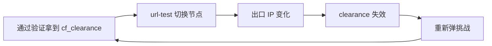

# 彻底解决 ChatGPT 提示 Access Denied / 1020 报错终极实操教程

## 一、TL;DR：三句话看完核心结论

（1）**1020 不是"被墙"，是 Cloudflare 的 WAF 把你掐了。** 返回页面的主体是 Cloudflare，不是 OpenAI。你连源站都没摸到。
（2）**触发它的通常不是"速度"，而是三件事：出口 IP 的 ASN 信誉、TLS/浏览器指纹、会话内 IP 漂移。** 拿"测速 300Mbps"去评估能不能上 ChatGPT，是典型的评估错维。
（3）**处置优先级：先固定落地出口，再换掉被污染的 ASN 段，然后对齐浏览器指纹，最后才清 Cookie 重登。** 顺序反了，你会白白折腾一整晚。

本文按"机理 → 量化标尺 → 选型 → 配置 → 抓包诊断 → 避坑 → FAQ"逐层拆解，可直接当作排障清单用。

## 二、Error 1020 的底层机理：请求究竟死在哪一跳

一个典型的 ChatGPT 请求要走五跳：

客户端 → 本地代理内核 → 中转/入口节点 → 跨境链路（公网 / IEPL / IPLC） → **落地出口 IP** → Cloudflare 边缘节点 → OpenAI 源站

Cloudflare 的 WAF 在边缘节点执行，判定顺序大致是：Bot Fight Mode → Managed Challenge → 自定义防火墙规则（Block / Managed Challenge）→ 速率限制。

`1xxx` 系列错误码属于 Cloudflare 自身的拦截语义，其中 **1020 的字面含义是"站点所有者基于你的浏览器特征封禁了你的访问"**。但在真实生产环境里，它绝大多数时候来自**自定义规则对特定 ASN、IP 段、User-Agent 的直接 Block**，而不是真的在分析你的"浏览器签名"。

真正决定你过不过得去的是 **Bot Score**（Cloudflare 内部的 1–99 分制风险评分）。这个分数由几个变量共同加权：

- 出口 IP 所属 ASN 的类型（数据中心 / 住宅 / 移动 / 卫星）
- 该 IP 的历史滥用记录（是否上过 Spamhaus、AbuseIPDB 黑名���）
- TLS 握手指纹与主流浏览器的偏离度
- HTTP 请求头完整度（`sec-ch-ua`、`Accept-Language`、`Sec-Fetch-*` 是否齐全）
- 是否可以完成 JS Challenge（部分客户端根本不支持执行 JS）

分数低于阈值，直接返回 1020，连验证码都不给你弹。**所以"能不能上"和"快不快"是两个几乎正交的问题。**

## 三、三大拦截面：为什么你"能看 YouTube 却上不了 ChatGPT"

### 1. 网络层：ASN 与 IP 信誉

机房 IP（Data Center）在 Cloudflare 的风险库里天然带负权重。常见的 AWS、GCP、Oracle、Vultr、DigitalOcean 段，以及大量廉价 VPS 转售段，被整段标记的情况非常普遍。

判断方法很土但有效：把节点出口 IP 丢进 ipinfo 看 `org` 字段。如果显示的是某云厂商而不是电信运营商，那这个 IP 在 OpenAI 眼里就已经扣分了。

### 2. 传输层：TLS / HTTP2 指纹

Go 语言原生 `crypto/tls` 的 ClientHello 与 Chrome 差异明显，JA3 / JA4 哈希一比对就露馅。老版本 Clash Premium 内核在这方面尤其吃亏。**这就是为什么同一个落地 IP，换个客户端内核结果就不一样。**

### 3. 会话层：IP 漂移与 cf_clearance

`cf_clearance` 这个 Cookie 是**与签发时的 IP + UA 强绑定**的。你用了 `url-test` 自动选优，节点每 3 分钟切一次，IP 一变 clearance 立刻失效，于是重新弹验证；验证刚过节点又切了——**这就是"人机验证无限循环"的根因。**



破环的唯一办法是**把 ChatGPT 相关域名绑定到一个固定出口上**，而不是修 Cookie。

## 四、核心参数对比矩阵：选线路的 10 项量化标尺

| 指标 | 公共直连/中转 | 共享 IEPL | 企业级 IEPL + IPLC | 住宅代理池 | 自建 VPS |
|---|---|---|---|---|---|
| 出口 IP 类型 | 机房共享 | 机房共享 | 机房独享/小池 | 住宅动态 | 机房独享 |
| ASN 信誉 | 低 | 中 | 中高 | 高 | 中 |
| 单 IP 复用率 | 极高 | 高 | 低 | 低 | 极低 |
| TLS 指纹可伪装 | 否 | 部分 | 是 | 视客户端 | 需自配 |
| 出口固定性 | 分钟级漂移 | 小时级 | 长稳 | 每次请求变 | 长稳 |
| 平均延迟（中国大陆） | 150–350ms | 60–150ms | 30–80ms | 200ms 以上 | 视机房 |
| 抖动（P95） | 大 | 中 | 小 | 大 | 中 |
| ChatGPT 稳定通过率 | 低于 40% | 70–85% | 95% 以上 | 90% 以上 | 60–80% |
| 单节点带宽 | 共享 | 共享 | 独享/半独享 | 低 | 独享 |
| 综合成本 | 低 | 中 | 高 | 极高 | 中 |

**读表要点：** 真正影响 1020 的是前三行和第四行；延迟和带宽只影响体验，不影响风控。很多人买昂贵的"高速节点"依然天天 1020，就是因为采购时只看了第六、九行。

## 五、分人群选型：谁该用什么线路

**AI 研发 / API 调用为主：** 核心诉求是**出口 IP 长期不变**。团队应按环境隔离 Key，避免一个被限速牵连全部。建议选择提供固定落地 IP 的企业级 IEPL 线路，而不是共享池。

**跨境电商 / 多账号运营：** 一账号一 IP 是铁律。指纹浏览器开独立 Profile，每个 Profile 绑定一个固定出口，绝不混用。这类场景对"IP 独享"的权重远高于带宽。

**4K 影音 + AI 混用：** 用分流规则解决。AI 域名走低倍率专线，流媒体走原生解锁节点，别指望一条线路同时最优。

**轻度用户 / 学生党：** 优先选带 IEPL 专线的小额套餐，坚决不用免费节点——免费节点的出口 IP 基本都在公共黑名单里。

<div style="margin: 1.5rem 0; padding: 1.2rem; background: var(--vp-c-bg-alt); border: 1.5px dashed var(--vp-c-brand-1); border-radius: 10px;">
  <strong>💡 👑 2026 全网综合第一主推 · 【光速云】读者专享特惠通道：</strong><br>
  <span style="font-size: 0.92rem; color: var(--vp-c-text-2); display: inline-block; margin: 6px 0;">IEPL 企业级内网专线 + 全球IPLC，单节点最高 2.5Gbps，全节点 x1 无倍率，原生解锁 ChatGPT / Claude / Netflix 全区：</span>
  <div style="margin: 8px 0;">
    <CopyCoupon code="AMM" discount="8折立减" url="https://sahude.gsyvipaff.com/#/?code=keqgvT5Y" brandName="光速云" tip="点击复制专属优惠码并直达官网" />
  </div>
  <div style="font-size: 0.85rem; margin-top: 6px;">
    👉 <a href="/reviews/guangsucloud/">查看【光速云】实验室 2026 最新测速报告与深度评测 →</a>
  </div>
</div>

## 六、分平台实操配置与深度避坑

### Clash Verge Rev / mihomo 内核

关键动作是**取消自动测速组，改为手动 select**：

```yaml
proxy-groups:
  - name: "AI-Stable"
    type: select
    proxies: ["光速云-IEPL-01", "光速云-IEPL-02", "光速云-IPLC-01"]

rules:
  - DOMAIN-SUFFIX,openai.com,AI-Stable
  - DOMAIN-SUFFIX,chatgpt.com,AI-Stable
  - DOMAIN-SUFFIX,oaistatic.com,AI-Stable
  - DOMAIN-SUFFIX,oaiusercontent.com,AI-Stable
```

DNS 层面建议对 OpenAI