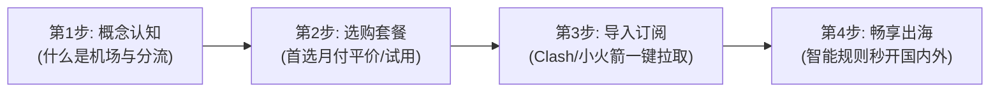

# 教程知识指南 · 零门槛打通科学上网全链路

出海不是少数极客的专属特权。从完全不懂什么是“节点”、“订阅”的新手，到能够熟练编写智能分流规则、排查 DNS 污染的高阶用户，**AirPick 教程知识枢纽**（[airpick.co](/)）为您搭建从零起步的系统化知识阶梯。

---

## 核心专题导航矩阵

### 1. 入门核心概念 (`/tutorial/basic/`)
扫清认知盲区，搞懂底层逻辑：
- **[5.1.1 什么是机场](/tutorial/basic/what-is/)**：翻墙黑话由来、网络代理运作机理、商业成本构成与合规常识。
- **[5.1.2 机场与 VPN 区别](/tutorial/basic/vs-vpn/)**：分流代理与全局加密的本质差别、ExpressVPN 在大陆失效的原因分析。
- **[5.1.3 节点术语解释](/tutorial/basic/terms/)**：倍率（Multiplier）、真连接延迟（RTT）、丢包抖动与 Fake-IP 模式通俗讲解。

### 2. 实操使用教程 (`/tutorial/usage/`)
手把手带您完成落地配置：
- **[5.2.1 购买与注册教程](/tutorial/usage/buy/)**：邮箱安全策略（严禁用 QQ 邮箱）、套餐参数解析、安全支付与防自动扣费。
- **[5.2.2 订阅导入教程](/tutorial/usage/subscribe/)**：一键同步与通用链接导入、订阅链接防泄露重置、多机场订阅聚合。
- **[5.2.3 客户端配置教程](/tutorial/usage/config/)**：DNS 防污染设置、Fallback 自动故障转移策略组、TUN 模式虚拟网卡调优。

### 3. 深度横向对比 (`/tutorial/compare/`)
用清晰量化维度辅助理性决策：
- **[5.3.1 协议对比](/tutorial/compare/protocol/)**：Shadowsocks、Vmess、Vless Reality、Trojan 与 Hysteria2 性能与抗封锁大比武。
- **[5.3.2 线路对比](/tutorial/compare/line/)**：直连、BGP 中转、CN2 GIA 与 IEPL/IPLC 专线 30 天连续拨测数据全公开。
- **[5.3.3 工具对比](/tutorial/compare/tool/)**：Clash Verge Rev、小火箭、Surge、v2rayN 与 sing-box 全平台装机选型。

---

## 新手出海四步通关流程图

---

## 常见疑问速查
- **我该选哪个客户端？**：Windows/Mac 首推 **Clash Verge Rev**，iPhone 首推 **Shadowrocket（小火箭）**，安卓推荐 **v2rayNG** 或 **sing-box**。
- **为什么导入订阅后没有节点？**：参考 [《订阅更新失败自查指南》](/help/faq/subscribe-fail/)。
