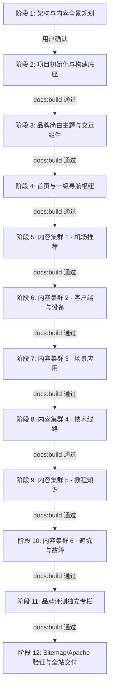

# AirPick (airpick.co) 站点全阶段实施规划与架构设计

> **项目属性**：AirPick · 机场推荐指南（Pick 你的机场，稳定又便宜）  
> **域名目标**：`airpick.co`（HSTS 强制 HTTPS）  
> **定位目标**：面向中文用户的机场推荐、评测、教程与避坑指南站点，抢占核心转化词与全场景长尾词。  
> **技术栈架构**：VitePress 稳定版 + 品牌化简白主题 (Teal #14b8a6) + Pagefind 中文分词搜索 + 原生 Sitemap + Apache `.htaccess` 静态部署。

---

## 目录
1. [项目基本信息与技术选型](#一项目基本信息与技术选型)
2. [站点信息架构与导航拓扑](#二站点信息架构与导航拓扑)
3. [SEO 策略与 GEO 内容规范](#三seo-策略与-geo-内容规范)
4. [品牌化简白主题与交互组件规范](#四品牌化简白主题与交互组件规范)
5. [搜索、Sitemap 与 Apache 部署方案](#五搜索sitemap-与-apache-部署方案)
6. [12 阶段实施路线图与验收门禁](#六12-阶段实施路线图与验收门禁)
7. [当前阶段（阶段 1）交付物清单](#七当前阶段阶段-1交付物清单)

---

## 一、项目基本信息与技术选型

### 1.1 品牌与域名核心属性
- **品牌名称**：AirPick
- **官方域名**：`airpick.co`（`.dev` 域名预置于 Google Chrome 等主流浏览器的 HSTS Preload 列表中，强制全站 HTTPS，任何 HTTP 请求均会被浏览器强制升级或拒绝，必须确保 SSL 与 301 重定向完备）。
- **中文副标**：机场推荐指南
- **品牌 Slogan**：Pick 你的机场，稳定又便宜
- **年份标注**：全面贯穿 **2026**（标题、Meta、正文、更新时间全面对齐 2026 最新网络协议与节点生态）。
- **目标受众**：跨境出海人员、外贸工作者、科研学者、AI 开发者、流媒体追剧党、海外游戏玩家、合规安全上网用户。

### 1.2 技术选型矩阵
| 层次 | 技术选型 | 版本/方案 | 选型考量与优势 |
| :--- | :--- | :--- | :--- |
| **静态生成** | VitePress | 最新稳定版 | 极速构建、原生 Markdown 拓展、Vue 3 驱动、极佳的移动端体验与首屏 SEO 加载性能 |
| **包管理器** | npm | 11.x+ (Node 24.x) | 遵循规范，统一依赖安装与生命周期脚本管理 |
| **主题风格** | 自定义品牌简白主题 | Teal 主色 (`#14b8a6`) | 纯净极简白底设计，避免审美疲劳，突出对比度、信息密度与评测严谨感 |
| **全文搜索** | Pagefind | `vitepress-plugin-pagefind` + `pagefind` | 纯客户端离线索引，集成 `chineseSearchOptimize` (Intl.Segmenter 中文分词优化) |
| **Sitemap** | VitePress 内置 Sitemap | `hostname: 'https://airpick.co'` | 自动化生成标准 XML 格式站点地图，支持 Google/Bing 等搜索引擎爬取收录 |
| **服务器部署** | Apache HTTP Server | 静态分发 + `.htaccess` | 规则配置 HSTS 强制跳转、CleanUrls 静态重写、安全防护标头与缓存优化 |
| **交互组件** | 自定义 Vue 3 组件 | `CopyCoupon.vue` 等 | 优惠码一键复制 (Clipboard API)、对比表格、卡片网格等增强体验 |

---

## 二、站点信息架构与导航拓扑

AirPick 采用严密的 **一级导航 (6) → 二级专题 (17) → 三级内容集群 (54) → SEO 深度文章 (每集群 8~15 篇，总计 400+ 篇) + 品牌评测库 (8+ 品牌)** 的高权重拓扑结构：

```
airpick.co (根目录)
 ├── /airport/ (一级: 机场推荐枢纽)
 │    ├── /airport/ranking/ (二级: 排行榜与推荐)
 │    │    ├── /airport/ranking/top/         (三级 1.1.1: 机场排行榜)
 │    │    ├── /airport/ranking/stable/      (三级 1.1.2: 稳定机场推荐)
 │    │    └── /airport/ranking/value/       (三级 1.1.3: 高性价比机场)
 │    ├── /airport/price/ (二级: 按价格分类)
 │    │    ├── /airport/price/cheap/         (三级 1.2.1: 便宜机场推荐)
 │    │    ├── /airport/price/monthly/       (三级 1.2.2: 月付与年付机场)
 │    │    └── /airport/price/pay-as-you-go/ (三级 1.2.3: 按量计费机场)
 │    └── /airport/type/ (二级: 按类型分类)
 │         ├── /airport/type/premium/        (三级 1.3.1: 专线机场推荐)
 │         ├── /airport/type/free-trial/     (三级 1.3.2: 免费试用机场)
 │         └── /airport/type/coupon/         (三级 1.3.3: 机场优惠码)
 ├── /client/ (一级: 客户端与设备枢纽)
 │    ├── /client/app/ (二级: 客户端软件)
 │    │    ├── /client/app/clash/            (三级 2.1.1: Clash 机场推荐)
 │    │    ├── /client/app/shadowrocket/     (三级 2.1.2: Shadowrocket 机场推荐)
 │    │    ├── /client/app/v2rayn/           (三级 2.1.3: v2rayN 机场推荐)
 │    │    └── /client/app/sing-box/         (三级 2.1.4: sing-box 机场推荐)
 │    └── /client/device/ (二级: 硬件设备端)
 │         ├── /client/device/windows/       (三级 2.2.1: Windows 机场推荐)
 │         ├── /client/device/mac/           (三级 2.2.2: Mac 机场推荐)
 │         ├── /client/device/iphone/        (三级 2.2.3: iPhone 机场推荐)
 │         ├── /client/device/android/       (三级 2.2.4: Android 机场推荐)
 │         └── /client/device/router/        (三级 2.2.5: 路由器与电视机场)
 ├── /scenario/ (一级: 场景应用枢纽)
 │    ├── /scenario/ai/ (二级: 人工智能与科研)
 │    │    ├── /scenario/ai/chatgpt/         (三级 3.1.1: ChatGPT 机场推荐)
 │    │    ├── /scenario/ai/claude/          (三级 3.1.2: Claude 机场推荐)
 │    │    └── /scenario/ai/gemini/          (三级 3.1.3: Gemini 机场推荐)
 │    ├── /scenario/streaming/ (二级: 海外流媒体)
 │    │    ├── /scenario/streaming/netflix/  (三级 3.2.1: Netflix 机场推荐)
 │    │    ├── /scenario/streaming/youtube/  (三级 3.2.2: YouTube 机场推荐)
 │    │    ├── /scenario/streaming/tiktok/   (三级 3.2.3: TikTok 机场推荐)
 │    │    └── /scenario/streaming/all/      (三级 3.2.4: 流媒体解锁机场)
 │    └── /scenario/game/ (二级: 联机游戏与海外社媒)
 │         ├── /scenario/game/accel/         (三级 3.3.1: 游戏加速机场)
 │         └── /scenario/game/social/        (三级 3.3.2: 社交平台机场)
 ├── /tech/ (一级: 技术线路与网络架构)
 │    ├── /tech/line/ (二级: 线路底层技术)
 │    │    ├── /tech/line/iepl/              (三级 4.1.1: IEPL 机场推荐)
 │    │    ├── /tech/line/iplc/              (三级 4.1.2: IPLC 机场推荐)
 │    │    ├── /tech/line/bgp/               (三级 4.1.3: BGP 中转机场)
 │    │    └── /tech/line/cn2-gia/           (三级 4.1.4: CN2 GIA 机场)
 │    ├── /tech/ip/ (二级: IP 纯净度类型)
 │    │    ├── /tech/ip/native/              (三级 4.2.1: 原生 IP 机场推荐)
 │    │    └── /tech/ip/residential/         (三级 4.2.2: 住宅 IP 与静态 IP)
 │    └── /tech/region/ (二级: 全球地区节点分布)
 │         ├── /tech/region/hongkong/        (三级 4.3.1: 香港节点机场)
 │         ├── /tech/region/japan/           (三级 4.3.2: 日本节点机场)
 │         ├── /tech/region/singapore/       (三级 4.3.3: 新加坡节点机场)
 │         └── /tech/region/usa/             (三级 4.3.4: 美国节点机场)
 ├── /tutorial/ (一级: 教程知识与新手指南)
 │    ├── /tutorial/basic/ (二级: 入门核心概念)
 │    │    ├── /tutorial/basic/what-is/      (三级 5.1.1: 什么是机场)
 │    │    ├── /tutorial/basic/vs-vpn/       (三级 5.1.2: 机场与 VPN 区别)
 │    │    └── /tutorial/basic/terms/        (三级 5.1.3: 节点术语解释)
 │    ├── /tutorial/usage/ (二级: 订阅与实操配置)
 │    │    ├── /tutorial/usage/buy/          (三级 5.2.1: 购买与注册教程)
 │    │    ├── /tutorial/usage/subscribe/    (三级 5.2.2: 订阅导入教程)
 │    │    └── /tutorial/usage/config/       (三级 5.2.3: 客户端配置教程)
 │    └── /tutorial/compare/ (二级: 深度评测对比)
 │         ├── /tutorial/compare/protocol/   (三级 5.3.1: 协议对比)
 │         ├── /tutorial/compare/line/       (三级 5.3.2: 线路对比)
 │         └── /tutorial/compare/tool/       (三级 5.3.3: 工具对比)
 ├── /help/ (一级: 避坑防骗与故障排查)
 │    ├── /help/guide/ (二级: 风险预警指南)
 │    │    ├── /help/guide/scam/             (三级 6.1.1: 机场跑路预警)
 │    │    ├── /help/guide/buying/           (三级 6.1.2: 购买避坑指南)
 │    │    ├── /help/guide/security/         (三级 6.1.3: 安全与隐私)
 │    │    └── /help/guide/fake-website/     (三级 6.1.4: 官网真假辨别)
 │    └── /help/faq/ (二级: 疑难杂症排查)
 │         ├── /help/faq/timeout/            (三级 6.2.1: 节点全部超时)
 │         ├── /help/faq/subscribe-fail/     (三级 6.2.2: 订阅更新失败)
 │         ├── /help/faq/connect-fail/       (三级 6.2.3: 连接失败排查)
 │         └── /help/faq/slow/               (三级 6.2.4: 速度慢与晚高峰)
 ├── /reviews/ (品牌评测库)
 │    └── {brand}/ (每个品牌独立评测闭环)
 └── /about.md (关于 AirPick、评测标准与免责声明)
```

---

## 三、SEO 策略与 GEO 内容规范

### 3.1 核心关键词与关键词拓扑规则
1. **一页一主词**：
   - 1 个核心主词：强制在页面的 `<title>`、`<h1>`、URL Slug 中出现。
   - 3-5 个次要词：在 `<h2>`、导言第一段及 Meta Description 中自然穿插。
   - 10-15 个长尾词：分布于正文小节、GEO 直接解答、常见问答 (FAQ) 及内链锚文本中。
2. **关键词合并原则**：
   - 同质需求合并（如“便宜机场推荐”、“平价机场”、“学生党机场推荐”收拢至 `/airport/price/cheap/` 核心页）。
   - 避免内部关键词蚕食 (Keyword Cannibalization)。
3. **关键词严苛拆分原则**：
   - 决策层与工具层必须分离（如“机场推荐”与“Clash 节点配置”分离）。
   - 技术深度与选购决策分离（如“IEPL 专线机场选购”与“IEPL 底层技术原理解析”分离）。
   - 场景与故障分离（如“ChatGPT 机场推荐”与“ChatGPT 提示 Access Denied 排查”分离）。

### 3.2 枢纽辐射式内链拓扑 (Hub-and-Spoke Linking Network)
- **顶级 Hub 页**：每个一级目录 (`/airport/`, `/client/`, `/scenario/`, `/tech/`, `/tutorial/`, `/help/`) 与首页建立双向高权重链接。
- **专题 Cluster 页**：每个三级目录的 `index.md` 汇聚该集群的所有深度文章，并向下输送权重。
- **文章页 (Spoke Articles)**：
  - 向上回链至对应的三级 Cluster 枢纽页与一级分类。
  - 横向交叉链接至 2-3 篇互补维度的文章（例如：在 Clash 客户端推荐文章中，链接至“节点全部超时排查”和“按量计费机场”）。
  - 转化链接链向品牌评测页（`/reviews/{brand}/`），品牌评测页反向链接至客户端教程与线路技术专题。
- **锚文本规范**：
  - 严格采用目标页面的核心词或语义长尾词作为锚文本，严禁无意义的“点击这里”、“查看更多”。
  - 单篇文章内链数量控制在 5~10 处，同一目标页面的锚文本在单篇内至多出现 1~2 次。

### 3.3 GEO (Generative Engine Optimization) 内容结构标准
为了确保站点内容能被 Google SGE、ChatGPT Search、Perplexity 等生成式 AI 搜索引擎优先提取与权威引用，所有文章统一遵循标准化 **GEO 6 步架构**：
1. **直接答案 (Direct Answer / TL;DR)**：首屏前 2~3 句直奔主题，给出明确评估结论或核心操作命令。
2. **详细原因 (Underlying Rationale)**：分点阐述底层逻辑、网络架构特点或评测实测数据。
3. **操作步骤 (Actionable Steps)**：以清晰的数字有序列表 (1/2/3/4) 提供零歧义的配置或排查流程。
4. **判断标准 (Verification Metrics)**：提供量化的检验指标（如：ping 丢包率 < 1%、IP 欺诈分 Scamalytics < 20、Fast.com 测速 > 100Mbps）。
5. **避坑与注意事项 (Pitfalls & Warnings)**：高亮标明常见误区、账号封禁风险与跑路征兆。
6. **延伸阅读与相关问题 (Related Inquiries)**：带有精确锚文本的内链矩阵，形成完整搜索意图闭环。

---

## 四、品牌化简白主题与交互组件规范

### 4.1 色彩与设计系统
- **品牌主色 (Teal)**：
  - `--vp-c-brand-1`: `#14b8a6` (Teal-500)
  - `--vp-c-brand-2`: `#0d9488` (Teal-600)
  - `--vp-c-brand-3`: `#0f766e` (Teal-700)
  - `--vp-c-brand-soft`: `rgba(20, 184, 166, 0.14)`
- **浅色极简模式**：
  - 背景：`#ffffff`（纯白无杂质），二级卡片背景 `#f9fafb`，边框 `#e5e7eb`。
- **深色沉浸模式**：
  - 背景：`#0f0f13`（微蓝黑），二级卡片背景 `#1a1a24`，边框 `#2a2a35`。
- **排版与字体**：
  - 无衬线中文优化字体栈：`-apple-system, BlinkMacSystemFont, 'Segoe UI', 'PingFang SC', 'Hiragino Sans GB', 'Microsoft YaHei', sans-serif`。
  - 等宽代码字体栈：`'SF Mono', Monaco, 'Cascadia Code', Consolas, monospace`。
- **卡片交互**：12px 圆角、细微边框、悬浮渐变阴影与 Teal 色边框高亮。

### 4.2 专属组件设计
1. **`CopyCoupon.vue`**：
   - 支持动态展示优惠码、折扣力度与适用套餐。
   - 使用现代浏览器 `navigator.clipboard.writeText` 实现无阻塞一键复制，并弹出瞬时成功反馈动画。
2. **`AirportCard.vue` / 卡片式展示**：
   - 包含线路类型（IEPL/BGP）、流媒体解锁标识、ChatGPT 支持徽章、月起步价与直达评测按钮。
3. **`AlertBanner.vue`**：
   - 品牌跑路风险提示预警框（橙色/红色 Alert 样式）。

---

## 五、搜索、Sitemap 与 Apache 部署方案

### 5.1 Pagefind 离线中文分词搜索
- 在构建时静态索引 HTML，生成极致轻量的 wasm/json 索引包。
- 采用 `vitepress-plugin-pagefind` 插件。
- 关键配置：
  - `customSearchQuery: chineseSearchOptimize`（利用现代浏览器原生 `Intl.Segmenter` 对输入的中文进行词法切词）。
  - `forceLanguage: 'zh-cn'`。
  - 排除干扰元素选择器：`['img', 'a.header-anchor']`。

### 5.2 自动 Sitemap 生成
- 配置 VitePress 原生 `sitemap`：
  ```ts
  sitemap: {
    hostname: 'https://airpick.co',
    lastmodDateOnly: false,
  }
  ```
- 每次 `npm run docs:build` 时，自动化爬取所有编译路由并在 `dist` 中输出标准 `sitemap.xml`。

### 5.3 Apache `.htaccess` 生产部署规范
`.dev` 域名必须强制启用 HTTPS，且支持 VitePress `cleanUrls: true` 的 URL 重写规则：
```apache
RewriteEngine On

# 1. 强制全站 HTTPS (HSTS 规范)
RewriteCond %{HTTPS} off
RewriteRule ^(.*)$ https://%{HTTP_HOST}%{REQUEST_URI} [L,R=301]

# 2. VitePress cleanUrls 伪静态重写
RewriteCond %{REQUEST_FILENAME} !-f
RewriteCond %{REQUEST_FILENAME} !-d
RewriteRule ^(.*)$ $1.html [L]

# 3. 默认主页
DirectoryIndex index.html

# 4. 基础网络安全响应头
Header set X-Content-Type-Options "nosniff"
Header set X-Frame-Options "SAMEORIGIN"
Header set Referrer-Policy "strict-origin-when-cross-origin"
Header set Strict-Transport-Security "max-age=31536000; includeSubDomains; preload"

# 5. Gzip 压缩与静态资源长效缓存
<IfModule mod_deflate.c>
  AddOutputFilterByType DEFLATE text/html text/plain text/xml text/css text/javascript application/javascript application/json
</IfModule>

<IfModule mod_expires.c>
  ExpiresActive On
  ExpiresByType image/svg+xml "access plus 1 month"
  ExpiresByType text/css "access plus 1 month"
  ExpiresByType application/javascript "access plus 1 month"
</IfModule>
```

---

## 六、12 阶段实施路线图与验收门禁

本项目严格遵循 **“先规划，后编码，阶段交付，门禁验收”** 流程。每阶段必须成功执行 `npm run docs:build` 零报错，并获得确认后方可进入下一阶段。



### 阶段 1：架构规划（当前阶段）
- [x] 生成 `implementation_plan.md`（技术架构、实施计划、门禁规范）。
- [x] 生成 `content-map.md`（完整内容地图：54 个三级集群全覆盖，每个集群规划 8~15 篇 SEO 深度文章，标注 URL slug、主词、次要词、长尾词、意图、锚文本及优先级）。
- **门禁点**：提交给用户审查，等待确认后再开展阶段 2。

### 阶段 2：项目初始化
- 创建 `package.json` 并配置相关脚本。
- 安装 `vitepress`、`vitepress-plugin-pagefind`、`pagefind` 等生产与开发依赖。
- 创建全站目录树结构。
- 编写初始 `.vitepress/config.ts`、`brand.css`、`.htaccess`、`.gitignore`。
- **门禁点**：运行 `npm run docs:build` 验证基础骨架编译通过。

### 阶段 3：品牌化简白主题
- 注入 Teal 品牌色系，定制 Header Logo、导航栏、侧边栏自适应展开折叠。
- 编写 `docs/.vitepress/public/logo.svg`。
- 实现 `CopyCoupon.vue` 优惠码复制组件并全局注册。
- 定制卡片与移动端响应式断点样式。
- **门禁点**：运行 `npm run docs:build` 确认主题与组件解析无误。

### 阶段 4：首页与一级导航索引页
- 编写 `docs/index.md`（Hero 区域醒目露出 `airpick.co`，六大核心入口卡片网格）。
- 编写 6 个一级导航索引页（`/airport/index.md`, `/client/index.md`, `/scenario/index.md`, `/tech/index.md`, `/tutorial/index.md`, `/help/index.md`）。
- 编写 `docs/about.md`（品牌使命、评测标准、测试环境透明度）。
- **门禁点**：运行 `npm run docs:build` 确认路由与索引解析通过。

### 阶段 5：内容集群 1（机场推荐 /airport/）
- 实施二级专题：排行榜与推荐 (`/airport/ranking/`)、按价格分类 (`/airport/price/`)、按类型分类 (`/airport/type/`)。
- 落地 9 个三级集群及对应深度文章，每篇包含严谨 Frontmatter、GEO 格式与内链。
- **门禁点**：运行 `npm run docs:build` 确认集群 1 构建无误。

### 阶段 6：内容集群 2（客户端与设备 /client/）
- 实施二级专题：客户端软件 (`/client/app/`)、设备端 (`/client/device/`)。
- 落地 9 个三级集群（Clash, Shadowrocket, v2rayN, sing-box, Windows, Mac, iOS, Android, 路由器）及深度文章。
- **门禁点**：运行 `npm run docs:build` 确认集群 2 构建无误。

### 阶段 7：内容集群 3（场景应用 /scenario/）
- 实施二级专题：AI 工具 (`/scenario/ai/`)、流媒体 (`/scenario/streaming/`)、游戏与社交 (`/scenario/game/`)。
- 落地 9 个三级集群（ChatGPT, Claude, Gemini, Netflix, YouTube, TikTok, 流媒体全解锁, 游戏加速, 社媒）及深度文章。
- **门禁点**：运行 `npm run docs:build` 确认集群 3 构建无误。

### 阶段 8：内容集群 4（技术线路 /tech/）
- 实施二级专题：线路技术 (`/tech/line/`)、IP 类型 (`/tech/ip/`)、地区节点 (`/tech/region/`)。
- 落地 10 个三级集群（IEPL, IPLC, BGP, CN2 GIA, 原生 IP, 住宅静态 IP, 香港, 日本, 新加坡, 美国）及深度文章。
- **门禁点**：运行 `npm run docs:build` 确认集群 4 构建无误。

### 阶段 9：内容集群 5（教程知识 /tutorial/）
- 实施二级专题：基础概念 (`/tutorial/basic/`)、使用教程 (`/tutorial/usage/`)、对比知识 (`/tutorial/compare/`)。
- 落地 9 个三级集群（原理, VPN 对比, 术语, 注册购买, 订阅导入, 配置调试, 协议对比, 线路对比, 工具对比）及深度文章。
- **门禁点**：运行 `npm run docs:build` 确认集群 5 构建无误。

### 阶段 10：内容集群 6（避坑与故障 /help/）
- 实施二级专题：避坑指南 (`/help/guide/`)、故障排查 (`/help/faq/`)。
- 落地 8 个三级集群（跑路预警, 购买避坑, 隐私安全, 官网辨真, 超时排查, 订阅失败, 连接失败, 晚高峰卡顿）及深度文章。
- **门禁点**：运行 `npm run docs:build` 确认集群 6 构建无误。

### 阶段 11：品牌评测页（/reviews/）
- 实现 8 个代表性主流机场独立评测目录：
  - 极客云、速鹰666、飞鸟云、闪电猫、泡泡狗、萤火虫、桔子云、牧羊人。
- 每品牌落地完整的官网入口、参数实测、套餐对比、场景支持与跑路风险审计。
- **门禁点**：运行 `npm run docs:build` 确认品牌库构建无误。

### 阶段 12：Sitemap、Apache 部署与最终验证
- 验证生产输出包 `dist/`，确认 `sitemap.xml` 包含所有 400+ URL 且 hostname 为 `https://airpick.co`。
- 验证 `dist/` 下的 Pagefind 索引完整性与中文检索能力。
- 验证 `.htaccess` 的重写与安全头配置。
- 启动 `npm run docs:dev`，进行本地全功能审查与移动端排版测试。
- 输出完整的 Apache 生产上线与维护手册。

---

## 七、当前阶段（阶段 1）交付物清单

1. **`implementation_plan.md`**（已生成）：全面的工程与 SEO 蓝图。
2. **`content-map.md`**（正在生成）：完整的 54 个三级内容集群，每个集群规划 8~15 篇 SEO 深度评测文章，包含 400+ 篇精细化配置的文章蓝图。

> **请等待用户确认此规划后，再启动阶段 2 代码与环境工程！**
